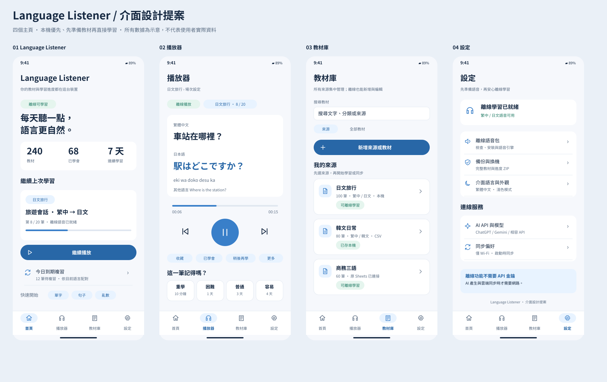

# UI/UX 設計規格（依已確認的 SVG 互動原型）

## 設計語言
- Material 3 + Jetpack Compose 原生 UI，非 WebView。
- 主色 #397FC9、深色文字 #172A43、淡藍卡片 #E8F3FF、白色背景 #FFFFFF。
- 大型播放按鈕、圓角卡片、清晰層級、單手操作；支援深色模式與 TalkBack。
- 底部導覽四區：首頁、播放器、教材庫、設定（含備份還原）。

## 首頁
- 標題 Language Listener、離線狀態。
- 歡迎區：「每天聽一點，語言更自然。」
- 教材總數、已學會、連續學習天數（真實統計）。
- 繼續學習卡：上次分類、播放位置、進度條。
- 快速開始：單字練習、句子聽力、亂數學習、複習已學。

## 聽力播放器
- 離線狀態、第 N/M 筆、分類與語言方向。
- 母語文字、目標語文字、可選第三語言。
- 進度條、上一筆、大型播放/暫停、下一筆。
- 跳過本次、已學會、暫時跳過、收藏、加入複習。
- 亂數、排除已學會、場次數量（20/50/100/自訂/全部）、語言順序、各語言語速、重複、間隔、循環。
- 變更設定須定義立即生效或下次建立場次生效，避免意外清空佇列。

## 教材庫
- 多個 Google Sheets URL、新增/移除/手動同步、最後同步時間、錯誤提示。
- 教材分類卡片：名稱、類型、筆數、語言；搜尋與篩選。
- AI 教材入口：供應商、API Key、主題、程度、語言、數量、審核、寫回 Sheets（後期）。
- 所有統計須來自 Room，不得寫死原型示意數字。

## 設定與備份還原
- 備份介紹；「僅學習紀錄」及「完整備份」。
- 標示「標準 ZIP 格式，不加密」；匯出與匯入按鈕。
- 匯入預覽：日期、筆數、版本、來源；完整覆蓋/智慧合併。
- 介面語言、深色模式、離線語音包檢查、同步網路政策。

## 驗收
- 四頁可正常切換，Android 返回鍵符合預期。
- 播放畫面、鎖屏、媒體通知狀態同步。
- 按鈕有實際功能；未開發項目須顯示尚未開放，不得模擬成功。
- 小螢幕無裁切、可用動態字級與 TalkBack。

## 2026-11-22 完整 SVG 介面提案

[設計說明與畫面索引](ui-svg/DESIGN_NOTES.md) 收錄 54 個手機畫面（含狀態、對話框與深色版）、1 個平板版及四張流程／總覽圖。解壓設計包後開啟 `index.html` 可搜尋與逐張查看。此為以 0.6.0 功能為基礎的導航與排版提案，尚未套用到 APK；數字及教材皆為示例。

